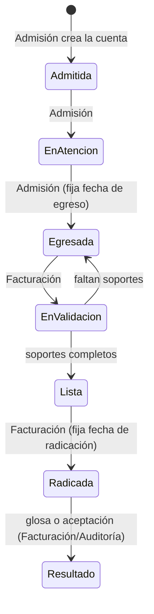

# Arquitectura (tres capas)

```
┌──────────────────────────── Presentación ────────────────────────────┐
│ Plantillas Django + CSS/JS propios (responsive) · formularios        │
│ views.py · forms.py · urls.py · context.py (rol y menú)              │
└───────────────────────────────┬──────────────────────────────────────┘
                                │ llama a
┌───────────────────────────────▼──────────────────────────────────────┐
│ Lógica de negocio (aplicación)                                       │
│ services.py: transiciones por rol, validación documental, plazos     │
│ en días hábiles, glosas · indicadores.py · permisos.py (roles)       │
└───────────────────────────────┬──────────────────────────────────────┘
                                │ ORM
┌───────────────────────────────▼──────────────────────────────────────┐
│ Datos                                                                │
│ models.py → PostgreSQL 16 (SQLite solo para pruebas locales)         │
│ Archivos de soportes en MEDIA_ROOT (descarga protegida por sesión)   │
└──────────────────────────────────────────────────────────────────────┘
```

## Decisiones

| Decisión | Motivo |
|---|---|
| Una sola app Django (`trazabilidad`) | Alcance TRL 5; evita complejidad innecesaria |
| Reglas de negocio en `services.py`, no en vistas | Se prueban sin HTTP y mantienen la separación en capas |
| Eventos inmodificables (modelo + queryset + admin de solo lectura) | RNF-02: la trazabilidad no se edita ni se borra desde la aplicación |
| Soportes obligatorios como datos (`ReglaSoporte`) | RF-02: cambian por entidad y servicio sin tocar código |
| Sin reglas parametrizadas ⇒ la cuenta no pasa la validación | Es preferible detener la radicación que enviar sin criterio |
| Admisión solo ve sus cuentas | RNF-01: cada rol accede solo a lo suyo |
| Configuración por variables de entorno | Sin secretos en el repositorio; mismo código en Docker y en la nube |
| Estáticos con WhiteNoise; sin CDN | El prototipo funciona sin conexión a terceros |

## Despliegue

- **Local:** `docker compose` → contenedores `db` (PostgreSQL) y `web` (gunicorn).
- **Prueba pública:** Render (`render.yaml`): servicio Docker + PostgreSQL gratuito. Ver `despliegue.md`.

## Máquina de estados


