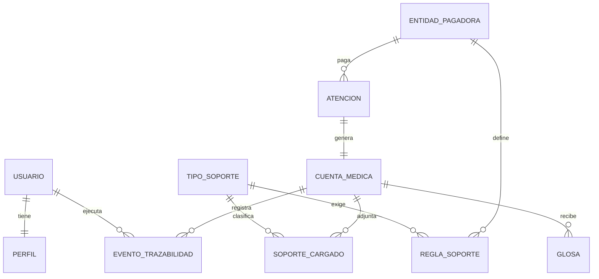

# Modelo de datos

| Entidad (modelo) | Campos principales | Notas |
|---|---|---|
| Usuario (`auth.User`) + `Perfil` | username, rol (admisión, facturación, auditoría, administrador) | El perfil se crea por señal al crear el usuario |
| `EntidadPagadora` | nombre, nit, plazo_radicacion_dias (22), activa | Plazo en días hábiles |
| `TipoSoporte` | nombre, descripción | Catálogo |
| `ReglaSoporte` | entidad, tipo_servicio, tipo_soporte | Única por combinación; define lo obligatorio |
| `Atencion` | documento y nombre del paciente, tipo_servicio, entidad, fecha_ingreso, fecha_egreso, creada_por | Datos seudonimizados en demostración |
| `CuentaMedica` | numero (único), atencion (1:1), valor, estado, resultado, fecha_radicacion | 7 estados; resultado = glosada/aceptada |
| `SoporteCargado` | cuenta, tipo, archivo, nombre_archivo, cargado_por, fecha | Descarga solo con sesión y alcance |
| `EventoTrazabilidad` | cuenta, fecha, usuario, tipo, estado_anterior, estado_nuevo, detalle | **Inmodificable**; FK a cuenta con `PROTECT` |
| `Glosa` | cuenta, causal, valor_glosado, descripcion, fecha, respondida, respuesta, fecha_respuesta | Causales: soportes, tarifas, autorizaciones, facturación, derechos, otra |

Restricciones: `numero` único; `ReglaSoporte` única por (entidad, servicio, soporte); `EventoTrazabilidad` no admite `save` sobre un registro existente, `delete` ni `update` masivo.
