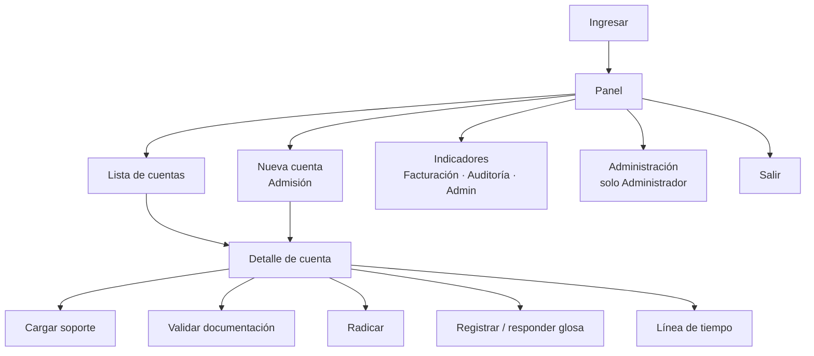

# Diagrama de navegación y mapa de pantallas

| Pantalla | Ruta | Roles |
|---|---|---|
| Ingreso | `/ingresar/` | Todos |
| Panel | `/` | Todos |
| Lista de cuentas | `/cuentas/` | Todos (Admisión: solo las propias) |
| Nueva cuenta | `/cuentas/nueva/` | Admisión, Administrador |
| Detalle de cuenta | `/cuentas/<id>/` | Todos (con alcance) |
| Indicadores | `/indicadores/` | Facturación, Auditoría, Administrador |
| Administración | `/admin/` | Administrador |

Los *mockups* de alta fidelidad (Figma) se generan a partir de estas pantallas; las capturas de la versión implementada están en la carpeta `docs/capturas/` (agregar tras la primera ejecución).
